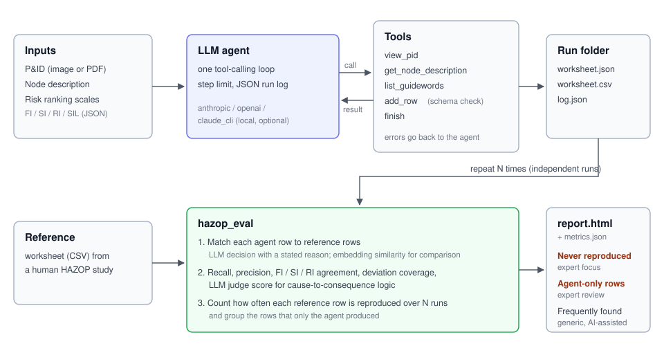
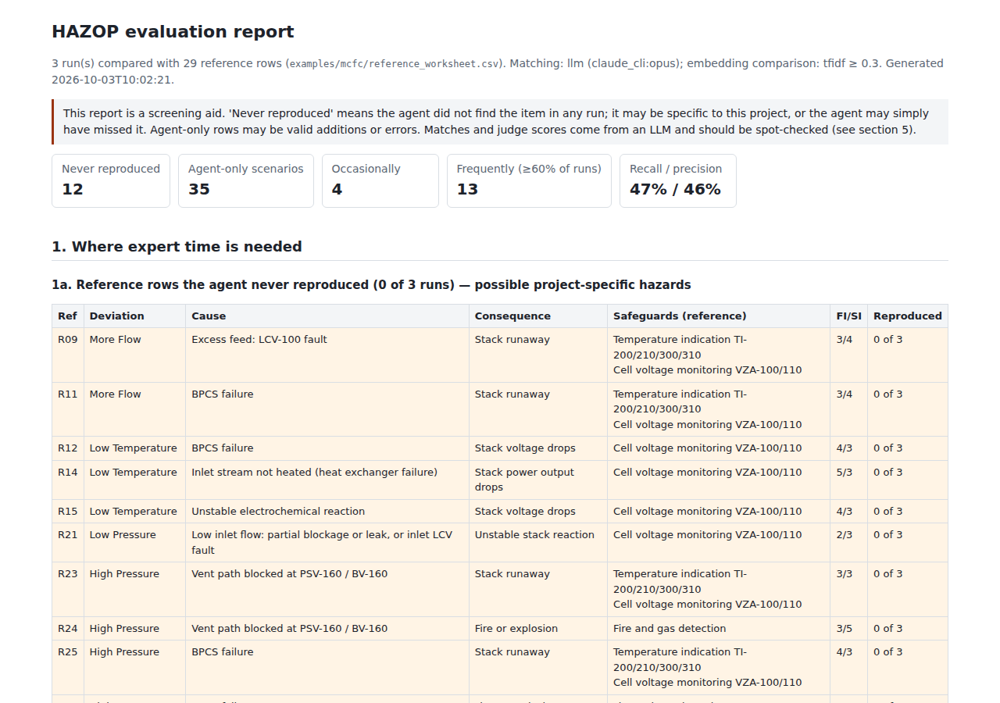

# hazop-agent

> **This repository is a deliberately simple, single-agent version.** A more elaborate multi-stage pipeline with additional verification is described in a manuscript in preparation.

A domain-specific AI agent that drafts a **HAZOP** (Hazard and Operability Study) worksheet from a P&ID and a node description, plus an evaluation tool that compares the draft with a worksheet written by a human HAZOP team.

## Why

In plant engineering (chemical and energy processes, nuclear and fusion facilities included) a HAZOP is mandatory, and it is expensive: a team of several specialists works through every node of every P&ID, guideword by guideword, often for weeks.

Much of that effort goes into items that look alike from project to project: the same guidewords, the same deviations, the same "control valve fails closed -> loss of flow" scenarios. The idea behind this repository:

- **let the AI draft the generic part** of the worksheet, and
- **spend the experts' time on the hazards that only this project has.**

The evaluation tool makes that split visible. Over several independent agent runs it sorts the reference worksheet into rows the agent **reproduces reliably** (generic items), rows it finds **only sometimes**, and rows it **never finds** (candidates for project-specific hazards), and it lists the scenarios **only the agent proposed** so that an expert can accept or reject them. The rows that need expert attention are at the top of the report.

## How it works



One LLM works in one tool-calling loop. It can look at the drawing (`view_pid`), read the node description (`get_node_description`), get the standard guidewords and parameters (`list_guidewords`), write worksheet rows (`add_row`) and stop (`finish`). `add_row` checks each row against the schema (FI and SI from 1 to 5, RI = FI x SI, SIL from 0 to 4, required text fields) and sends errors back to the agent, which then fixes the row. The loop has a step limit, and every run writes its worksheet and a JSON log of all tool calls.

For comparison there is also a **single-call mode** (`--mode single`): the same inputs in one prompt, the whole worksheet in one answer, no tools.

Worksheet row fields: `node, deviation, causes, consequences, safeguards, FI, SI, RI, SIL, recommendations`.

## Quickstart

Requires Python 3.10 or newer.

```bash
git clone https://github.com/NNOOHHDD/hazop-agent.git
cd hazop-agent
python -m venv .venv && source .venv/bin/activate      # Windows: .venv\Scripts\activate
pip install -r requirements.txt
cp .env.example .env                                    # then put your API key in .env

# try the whole flow offline first (scripted fake LLM, placeholder output, no API call)
python -m hazop_agent --pid examples/mcfc/pid.jpg --node examples/mcfc/node.md --provider fake --out results/smoke

# one real run
python -m hazop_agent --pid examples/mcfc/pid.jpg --node examples/mcfc/node.md --out results/agent
```

Each run is written to `<out>/run_NN/` (existing runs are never overwritten):

| File | Content |
|---|---|
| `worksheet.json` | run metadata (model, status, steps, tokens) and the rows |
| `worksheet.csv` | the same rows as a table |
| `log.json` | system prompt, every step, every tool call with its result (images omitted) |

### Inputs

- **P&ID**: an image (`.png`, `.jpg`, ...) or a PDF (the first page is rendered). The image is re-encoded as PNG without metadata; the long side is capped at 2000 px (`HAZOP_PID_MAX_SIDE`).
- **Node description**: a text file whose first line is `# <node name>`, followed by the scope and design intent. See [examples/mcfc/node.md](examples/mcfc/node.md).
- **Risk ranking scales**: [hazop_agent/data/risk_criteria.json](hazop_agent/data/risk_criteria.json), with the source of each table stated in the file. Use your project's own matrix with `--criteria my_matrix.json`.

### LLM providers

| `HAZOP_LLM_PROVIDER` | Needs | Default model |
|---|---|---|
| `anthropic` (default) | `ANTHROPIC_API_KEY` | `claude-opus-5-5` |
| `openai` | `OPENAI_API_KEY` | none, set `HAZOP_LLM_MODEL` |
| `claude_cli` | a logged-in local [Claude Code](https://code.claude.com) CLI (optional, no API key) | `opus` |
| `fake` | nothing | scripted placeholder for tests |

`--provider` and `--model` override the environment. With `anthropic`, requests are streamed, effort is set by `HAZOP_ANTHROPIC_EFFORT` (default `high`), and the server-side refusal fallback (beta) is on unless `HAZOP_ANTHROPIC_FALLBACK=off`. `claude_cli` cannot take custom tool definitions, so tool calls are emulated with a JSON reply protocol and the whole transcript is re-sent each step; it is slower and meant for trying the agent without an API key.

## Evaluation

```bash
python -m hazop_eval --reference examples/mcfc/reference_worksheet.csv \
    --runs results/agent/run_* --node examples/mcfc/node.md --out results/eval
```

Writes `metrics.json` (all numbers), `matches.json` (every matched pair with its reason) and a self-contained `report.html`. LLM answers are cached in `llm_cache.json` in the same folder, so re-running the evaluation costs nothing. The matcher and judge use `HAZOP_EVAL_PROVIDER` / `HAZOP_EVAL_MODEL` when set, otherwise the agent's provider.

### Metrics

| Metric | Definition |
|---|---|
| **Matching** | An LLM reads one agent row against all reference rows and names the reference rows that describe the *same scenario* (same initiating cause and same kind of consequence; wording and level of detail may differ; deviation direction must be compatible). The one-sentence reason is stored for every match. Matching is many-to-many. |
| **Embedding matching** (comparison) | Cosine similarity of `deviation + cause + consequence` above a threshold. `--embedding tfidf` (default, offline, lexical) or `--embedding openai` (`text-embedding-3-small`). Reported next to the LLM matcher with Cohen's kappa over the full agent x reference grid. Thresholds are not calibrated; set `--threshold`. `--matcher embedding` makes it the primary matcher (no LLM needed with `--no-judge`). |
| **Recall** | Share of reference rows matched by at least one agent row. |
| **Precision** | Share of agent rows that match at least one reference row. Unmatched agent rows are not necessarily wrong: they are listed for expert review. |
| **F1** | Harmonic mean of the two. |
| **FI / SI / RI agreement** | Over matched pairs: exact agreement, agreement within one step (FI, SI), mean absolute and mean signed difference (agent minus reference). |
| **Deviation coverage** | Share of the reference's guideword-parameter combinations (e.g. *Less Flow*, *More Temperature*) that the agent addressed. Synonyms are folded (*Low* = *Less*, *High* = *More*), and *No* counts as the extreme of *Less*. |
| **Reproducibility** | Over N runs: in how many runs each reference row was matched. |
| **Triage** | *Frequently reproduced* (in at least 60% of runs, `--frequent`): generic items the agent handles. *Occasionally*: found in some runs. *Never reproduced*: possible project-specific hazards, or misses; an expert decides. *Agent-only*: unmatched agent rows from all runs, grouped into near-duplicates, with the number of runs that produced them. |
| **Judge score** | An LLM rates the cause -> consequence logic of each agent row from 1 (wrong) to 5 (correct and specific), with a reason. Safeguards and ratings are not judged. `--no-judge` skips it. |

The report lists, in this order: reference rows never reproduced, agent-only scenarios, occasionally reproduced rows, frequently reproduced rows, the metric tables, and the match evidence for every reference row.

### Reference worksheet format

CSV with the columns `ref_id, node, deviation, guideword, parameter, causes, consequences, safeguards, FI, SI, RI, SIL, recommendations`. Multiple safeguards or recommendations are separated by `;`. Empty cells are allowed. See [examples/mcfc/reference_worksheet.csv](examples/mcfc/reference_worksheet.csv).

## Demo: MCFC stack

The example in [examples/mcfc/](examples/mcfc/) is the stack node of a molten carbonate fuel cell (MCFC) system for ship propulsion, with a 29-row reference worksheet restructured from Ahn et al. (2019). Three agent runs and the evaluation report:

```bash
python -m hazop_agent --pid examples/mcfc/pid.jpg --node examples/mcfc/node.md \
    --runs 3 --out examples/mcfc/results/agent
python -m hazop_eval --reference examples/mcfc/reference_worksheet.csv \
    --runs examples/mcfc/results/agent/run_* --node examples/mcfc/node.md \
    --out examples/mcfc/results/eval
open examples/mcfc/results/eval/report.html      # macOS; use xdg-open on Linux
```

Add `--mode single --out examples/mcfc/results/single` to the first command for the single-call comparison.

### Example result

Three runs with the `claude_cli` provider (model `opus`, 2026-10-03) are committed in [examples/mcfc/results/](examples/mcfc/results/). In this small-sample example, recall was 0.47 and precision 0.46 (means over 3 runs). Of the 29 reference rows, 13 were reproduced frequently, 4 occasionally and 12 never, and the agent proposed 35 scenarios of its own. Run conditions, risk-ranking agreement and caveats are in [examples/mcfc/results/README.md](examples/mcfc/results/README.md).



## MCP server

The agent and the evaluator are also available as two MCP tools, `generate_worksheet` and `evaluate_worksheet`, over stdio:

```bash
pip install -r requirements-mcp.txt
python -m hazop_agent.mcp_server
```

Example client entry (e.g. Claude Desktop or Claude Code):

```json
{"mcpServers": {"hazop-agent": {"command": "/path/to/hazop-agent/.venv/bin/python",
                                "args": ["-m", "hazop_agent.mcp_server"],
                                "cwd": "/path/to/hazop-agent"}}}
```

The server uses `mcp` 2.x, where the former `FastMCP` class is named `MCPServer`.

## Tests

```bash
pip install -r requirements-dev.txt
pytest -q
```

The tests use the scripted fake LLM only and make no network calls: schema validation, P&ID loading (image and PDF), the agent loop and single mode, message conversion for each provider, matching, metrics, triage, the report, and the MCP tool list.

## Limitations

- **A draft, not a HAZOP.** The output is a starting point for a qualified HAZOP team. It must not be used for design or safety decisions without that team's review.
- **One node, one image.** The agent sees one drawing at the resolution it is given. Small or blurred tags may be misread; check every tag the agent cites against the drawing.
- **LLM-based evaluation.** Matching and judge scores are themselves LLM judgements. Read the stored reasons and spot-check them; compare with the embedding matcher. Results depend on the model used for evaluation.
- **"Never reproduced" is not proof of project specificity.** It may also be a plain miss by the agent, or an artefact of how the reference worksheet was written. The triage only tells an expert where to look first.
- **The reference is one team's study.** Recall measures agreement with that worksheet, not completeness or correctness. Agent-only rows can be valid hazards the reference does not list.
- **Run-to-run variation.** LLM outputs differ between runs; use several runs (`--runs`) before drawing conclusions. Each run costs API tokens.
- **Risk scales.** The FI / SI scales are adapted from the example's source paper and the SIL matrix is an illustrative default; neither is a normative table. Calibrate them for your project.

## Citation

Please cite this software with the metadata in [CITATION.cff](CITATION.cff).

The MCFC example is based on:

> Ahn J., Noh Y., Joung T., Lim Y., Kim J., Seo Y., Chang D. Safety integrity level (SIL) determination for a maritime fuel cell system as electric propulsion in accordance with IEC 61511. *International Journal of Hydrogen Energy* 44(5):3185-3194, 2019. doi:[10.1016/j.ijhydene.2018.12.065](https://doi.org/10.1016/j.ijhydene.2018.12.065)

- P&ID figure ([examples/mcfc/pid.jpg](examples/mcfc/pid.jpg)): Reproduced from Ahn et al. (2019), © 2019 Hydrogen Energy Publications LLC, published by Elsevier, with permission of the corresponding author.
- Reference worksheet ([examples/mcfc/reference_worksheet.csv](examples/mcfc/reference_worksheet.csv)): Restructured from Ahn et al. (2019).

## License

The code is released under the [MIT License](LICENSE). The MIT License does not cover the P&ID figure in `examples/mcfc/pid.jpg`, which is reproduced with permission and remains © 2019 Hydrogen Energy Publications LLC.
